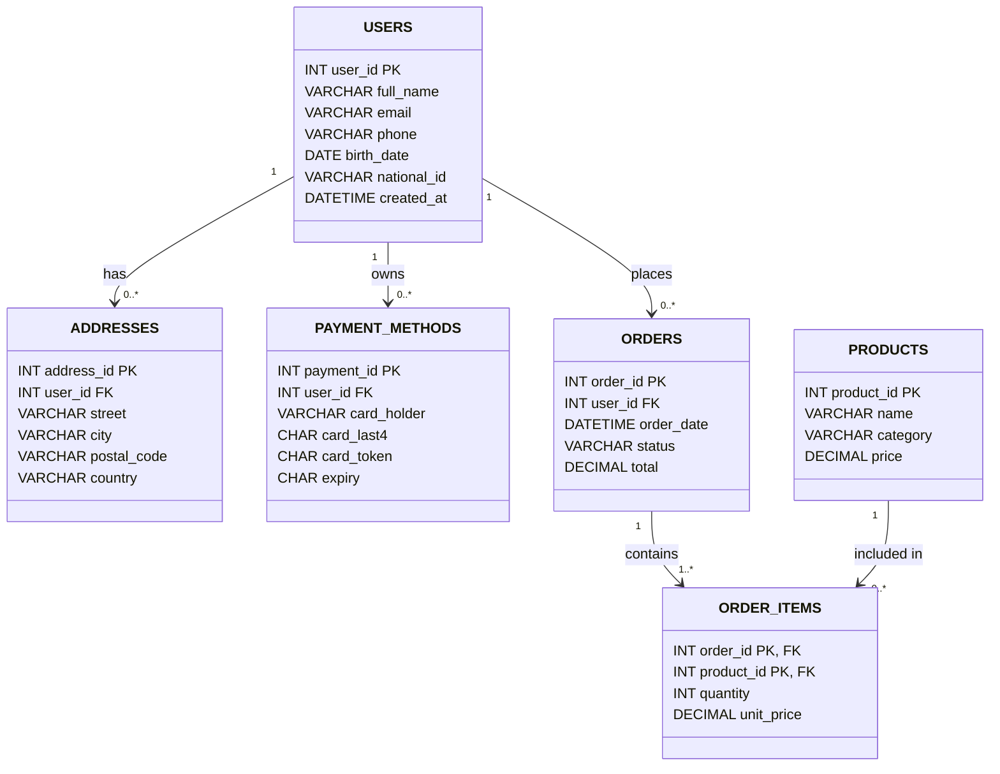

A project for area 10, "Encryption and key management" for the MariaDB student database projects, 2026-09. ([project page](https://mariadb.org/bachelor_hackathon_2026-09/))

# Encryption at rest and key management in MariaDB

Authors: Mercedes Dager, Claudia Nicolae, Francisco Silva, Daris Naska

We encrypt a generated online-shop database (about 4 million rows) with MariaDB table encryption and keep the keys in HashiCorp Vault instead of in a key file. We rotate a key while the server is running, measure what encryption costs, and check what someone who only has the data files can see.

Two results stand out:

- **A plugin default made encryption 15 times slower.** On MariaDB 10.11.14, the Vault key plugin cut throughput by 93% with its default settings. One option fixes it (see "Findings").
- **An unreachable Vault can take the server down.** MariaDB does not start without Vault. A running server crashed in both of our runs once its cached key information had expired (see "What happens when the key manager is unavailable").

## Try it in 10 commands

This shows the feature from start to finish: keys in Vault, the key plugin in MariaDB, six encrypted tables, and what the raw data file looks like before and after. You need Ubuntu 24.04. On our laptop this sequence takes a few minutes, mostly the data load. A slower machine or disk will take longer. `me` is just the name of your results folder. This is the short path: it skips the benchmarks and the key rotation, which the full run in "Setup" below adds.

```bash
git clone https://github.com/ClaudiaNicolae1/CU-Database-Project.git
cd CU-Database-Project
bash scripts/setup.sh
bash scripts/attack_view.sh unencrypted me
bash scripts/enable_encryption.sh
sudo mariadb < sql/encrypt_tables.sql
sudo mariadb -e "SELECT name, current_key_id, current_key_version, rotating_or_flushing FROM information_schema.INNODB_TABLESPACES_ENCRYPTION WHERE name LIKE 'shop/%';"
bash scripts/verify.sh
bash scripts/attack_view.sh encrypted me
sudo docker exec -e VAULT_ADDR=http://127.0.0.1:8200 -e VAULT_TOKEN=root vault vault kv metadata get mariadb/2
```

What each step does, and what you should see:

1. `setup.sh` installs MariaDB and Vault, creates two keys in Vault (`mariadb/1` and `mariadb/2`), generates the data and loads about 4 million rows into the database `shop`, still unencrypted.
2. The first `attack_view.sh` searches the raw data file `users.ibd` for the email and the name of user 1, the way someone with only the files would. In our run the email was found once. The name was found 1,982 times, but the generated names repeat, so the name matches every row that shares it, while the email belongs to user 1 only.
3. `enable_encryption.sh` points MariaDB at Vault and turns encryption on. `encrypt_tables.sql` then encrypts the six tables: key 2 for the personal data (`users`, `addresses`, `payment_methods`), key 1 for the rest.
4. The `SELECT` shows each table with its key id and key version. You should see six rows, key 2 on three and key 1 on three, version 1. If `rotating_or_flushing` is 1 on any row, run it again until it is 0.
5. `verify.sh` runs 15 checks and should end with `ALL CHECKS PASSED`.
6. The second `attack_view.sh` repeats the search on the encrypted file. The email count should be 0 (it was 1 before), and so should the name count.
7. The last command shows the metadata of key 2 in Vault: `current_version` and, for each version, when it was created (the key itself is not shown). On a fresh setup it says `current_version 1`, with one version listed. Each rotation adds a version, so on our laptop, after three rotation runs, it says 7.

Dev-mode Vault keeps its keys in memory, so do not reboot or remove the Vault container while you use the encrypted tables (see "What happens when the key manager is unavailable"). The rest of this README covers the benchmarks, the slowdown we found, and the Vault outage tests.

## Contents

- [Try it in 10 commands](#try-it-in-10-commands): the feature from start to finish
- [What the project covers](#what-the-project-covers): the goals of the area and where each one is done
- [What is in the repo](#what-is-in-the-repo)
- [Requirements and versions](#requirements-and-versions)
- [Setup (Ubuntu 24.04)](#setup-ubuntu-2404): the commands to reproduce everything
- [Data model](#data-model): the six tables and why they are split this way
- [How encryption is set up in MariaDB](#how-encryption-is-set-up-in-mariadb)
- [Method of the measurements](#method-of-the-measurements)
- [Findings: one Vault plugin setting caused a ~15x slowdown](#findings-one-vault-plugin-setting-caused-a-15x-slowdown): the main result
  - [How the cause was found](docs/slowdown-diagnosis.md): the commands and results of each experiment
- [Results on different machines](#results-on-different-machines)
- [Key rotation while serving traffic](#key-rotation-while-serving-traffic): the summary, with the details in docs/
- [What the data files show before and after](#what-the-data-files-show-before-and-after)
- [What happens when the key manager is unavailable](#what-happens-when-the-key-manager-is-unavailable): the summary table, with the details in docs/
  - [Extra tests: what a running server needs from Vault](docs/vault-outages.md#extra-tests-what-a-running-server-needs-from-vault-beyond-what-the-area-asks)
- [Coverage of the MariaDB encryption documentation](#coverage-of-the-mariadb-encryption-documentation): what we used from each part
- [Where this approach loses](#where-this-approach-loses)
- [Limits](#limits)

## What the project covers

| Goal of the area | Where | Status |
|---|---|---|
| Dataset encrypted with a key manager, not a key in a file | `scripts/setup.sh`, `scripts/enable_encryption.sh`, `sql/encrypt_tables.sql`, `scripts/extra/integrity_check.sh` | done |
| Key rotated while the server serves traffic | `scripts/rotate_under_load.sh` | done |
| What the data files show before and after | `scripts/attack_view.sh` | done |
| Performance cost measured, not estimated | `scripts/bench.sh`, `scripts/shop_bench.sh`, `scripts/extra/rw_bench.sh` | done |
| Reproducible from this README, key manager included | `scripts/setup.sh`, `scripts/verify.sh` | done |
| What happens when the key manager is unavailable | `scripts/vault_down.sh`, `scripts/extra/` | done |

## What is in the repo

- `scripts/`: setup, attacker view, benchmarks, key rotation, checks (`verify.sh`), and `stats.sh` (mean and standard deviation of the sysbench runs)
- `scripts/extra/`: tests beyond what the project asks: Vault outages, the rotation probe, the integrity check and the read-only and write-only sysbench runs
- `sql/`: schema of the test database (`shop`), the statements that encrypt it, and the query workload (`workload.sql` has no `USE` statement, so run it with the `shop` database selected, as `shop_bench.sh` does)
- `results/<name>/`: outputs, one folder per person. The `extra/` folder inside holds the outputs of the extra tests, and `experiments/` the outputs of the diagnosis.

## Requirements and versions

- Ubuntu 24.04 on a native install. Other systems are untested.
- MariaDB 10.11.14 (Ubuntu package) with `mariadb-plugin-hashicorp-key-management`
- HashiCorp Vault 2.1.1, run in Docker in dev mode (image `hashicorp/vault:2.1.1`)
- sysbench 1.0.20, g++ (builds the data generator), binutils and xxd (attacker view)
- `sudo` rights and several GB of free disk space

`scripts/setup.sh` installs all of it.

## Setup (Ubuntu 24.04)

One command runs everything, from installing the packages to the key rotation. It stops at the first step that fails and writes a log to `results/NAME/run_all.log`:

```bash
git clone https://github.com/ClaudiaNicolae1/CU-Database-Project.git
cd CU-Database-Project
bash scripts/run_all.sh NAME
```

It took about 21 minutes on our laptop, with the packages already installed. The longest step is the wait for InnoDB to encrypt the `sbtest` tables (about 9 minutes), followed by six timed minutes of sysbench and the 4-minute rotation test. The integrity checks and the read-only and write-only sysbench runs were added after that run and add about 5 minutes (four more timed minutes of sysbench). A slower machine, and the package installation on a clean one, will take longer. The 10-command tutorial above is the short path.

Use it on a fresh Ubuntu 24.04 machine. It stops at the start if the Vault key plugin is already configured (`/etc/mysql/mariadb.conf.d/60-encryption.cnf` exists) or if the `sbtest` tables are already encrypted, because the unencrypted baseline would then be measured on encrypted tables. `FORCE=1 bash scripts/run_all.sh NAME` skips that check, and the unencrypted numbers may then be wrong. `DRY_RUN=1 bash scripts/run_all.sh NAME` only prints the steps.

The same steps as `run_all.sh`, one by one. This is the full run, with the benchmarks and the key rotation. The 10-command demo above is the short version:

```bash
git clone https://github.com/ClaudiaNicolae1/CU-Database-Project.git
cd CU-Database-Project
bash scripts/setup.sh
bash scripts/extra/integrity_check.sh unencrypted NAME
bash scripts/attack_view.sh unencrypted NAME
bash scripts/shop_bench.sh unencrypted NAME
bash scripts/bench.sh unencrypted NAME
bash scripts/extra/rw_bench.sh unencrypted NAME
bash scripts/enable_encryption.sh
sudo mariadb < sql/encrypt_tables.sql
sudo mariadb -e "SELECT name, current_key_id, rotating_or_flushing FROM information_schema.INNODB_TABLESPACES_ENCRYPTION WHERE name LIKE 'shop/%';"
bash scripts/verify.sh
bash scripts/extra/integrity_check.sh encrypted NAME
bash scripts/attack_view.sh encrypted NAME
bash scripts/shop_bench.sh encrypted NAME
bash scripts/bench.sh encrypted NAME
bash scripts/extra/rw_bench.sh encrypted NAME
bash scripts/rotate_under_load.sh NAME
bash scripts/stats.sh NAME
```

Use your own name instead of `NAME`. Your results go to `results/NAME/`. Before the encrypted steps, wait until `rotating_or_flushing` is 0 for every row of the query above.

Vault runs in Docker in dev mode with the token `root`. Dev mode keeps keys in memory, so if the container is removed, or restarted after a reboot, the keys are gone and the encrypted tables cannot be read (see "What happens when the key manager is unavailable").

`scripts/verify.sh` checks the running setup against this README. It checks that the Vault plugin is active, that encryption is on, that each of the six tables uses the right key, that the row counts match, that the name of user 1 cannot be found in the raw `users.ibd` file, that both keys exist in Vault, and that the cache option is set. It exits with a non-zero code if any check fails.

## Data model

The database `shop` has six InnoDB tables (`sql/schema.sql`):

| Table | Key columns | Holds | Encryption key |
|---|---|---|---|
| `users` | `user_id` | name, email, phone, birth date, national id | 2 |
| `addresses` | `address_id`, `user_id` (FK users) | street, city, postal code, country | 2 |
| `payment_methods` | `payment_id`, `user_id` (FK users) | card holder, last 4 digits, token, expiry | 2 |
| `products` | `product_id` | name, category, price | 1 |
| `orders` | `order_id`, `user_id` (FK users) | date, status, total | 1 |
| `order_items` | (`order_id`, `product_id`), FKs to orders and products | quantity, unit price | 1 |

**UML Diagram**



**Legend**

- **PK** – Primary Key
- **FK** – Foreign Key
- **1** – Exactly one
- **0..*** – Zero or many
- **1..*** – One or many
- **1:1** – One-to-One relationship
- **1:N** – One-to-Many relationship
- **M:N** – Many-to-Many relationship
- **Class (Rectangle)** – Represents a database table.
- **Connecting Line** – Represents a relationship between tables.

Why it is built this way:

- The personal data (users, addresses, payment methods) sits in separate tables from the shop data, so the two groups can use different keys (2 and 1) and be rotated separately. Rotating key 2 touches only three small tables. `orders` and `order_items` are much bigger.
- `schema.sql` creates every table with `ENCRYPTED=NO`, so we can measure an unencrypted baseline. `encrypt_tables.sql` then encrypts each table with `ALTER TABLE ... ENCRYPTED=YES ENCRYPTION_KEY_ID=n`. Each table's key is set explicitly and does not depend on background conversion.
- The data is synthetic, because real personal data cannot be published. `scripts/generate_data.cpp` (fixed seed 1, and a fixed order of the random draws, so every compiler gives the same data) writes CSV files for 200,000 users, 1,000,000 orders and about 2.5 million order items, and `scripts/load_data.sh` loads them with `LOAD DATA LOCAL INFILE`. The structure and size are made to seem realistic. The generated files are not committed (`data/` is ignored). `setup.sh` creates them.

## How encryption is set up in MariaDB

`scripts/enable_encryption.sh` writes `/etc/mysql/mariadb.conf.d/60-encryption.cnf`:

```
[mariadb]
plugin_load_add = hashicorp_key_management
hashicorp-key-management-vault-url = http://127.0.0.1:8200/v1/mariadb
hashicorp-key-management-token = root
hashicorp-key-management-cache-version-timeout = 60000
innodb_encrypt_tables = ON
innodb_encrypt_log = ON
innodb_encryption_threads = 4
encrypt_tmp_files = ON
```

- The plugin reads keys from a Vault KV v2 mount named `mariadb`. `setup.sh` creates two secrets, `mariadb/1` and `mariadb/2`. Each holds a random 32-byte key (64 hex characters) in the field `data`. The number is the key id that `ENCRYPTION_KEY_ID` refers to.
- `innodb_encrypt_log` and `encrypt_tmp_files` cover the redo log and temporary files. `innodb_encryption_threads` are the background workers that re-encrypt pages when a key version changes.
- `cache-version-timeout` is the option behind the main finding below.

## Method of the measurements

- Held constant: the same machine, MariaDB and OS, the same sysbench parameters, and the same configuration apart from encryption.
- sysbench `oltp_read_write` on 8 tables with 500,000 rows each (`sbtest`), 8 threads, 60 s per run, 3 runs per configuration (`scripts/bench.sh`).
- Encrypted runs start only after all eight tables show `encryption_scheme = 1` and `rotating_or_flushing = 0`. `bench.sh` waits for this.
- Metrics: transactions per second and latency (average and 95th percentile) from sysbench. We list every run so the spread is visible.
- `scripts/shop_bench.sh` times five queries on the `shop` tables with `mariadb-slap` (`sql/workload.sql`): a point lookup, a join, an update and two full-table aggregations. Four clients run the set three times. We ran it twice per state and kept the second run.

## Findings: one Vault plugin setting caused a ~15x slowdown

On MariaDB 10.11.14, encrypted throughput dropped by 93% with the default settings. One option brought most of it back: the cost fell to about 14% (9% in the first series, 20% in a repeat).

Test machine: Lenovo ThinkPad T16 Gen 4, Intel(R) Core(TM) Ultra 5 225U, 14 threads, 32 GB, Ubuntu 24.04, MariaDB 10.11.14, sysbench 1.0.20. Numbers from other machines will differ.

sysbench `oltp_read_write`, 8 threads, 60 s, average of 3 runs (files in `results/claudia/`):

| Configuration | Transactions/s | p95 latency (ms) |
|---|---|---|
| Unencrypted | 2661 | 4.74 |
| Encrypted, default plugin settings | 179 | 272.6 |
| Encrypted, `cache-version-timeout=60000` | 2423 | 6.30 |

The individual runs (transactions/s and p95 latency in ms):

| Configuration | Run 1 | Run 2 | Run 3 |
|---|---|---|---|
| Unencrypted | 2826 / 4.57 | 2637 / 4.65 | 2521 / 5.00 |
| Encrypted, default plugin settings | 194 / 240.0 | 190 / 227.4 | 153 / 350.3 |
| Encrypted, `cache-version-timeout=60000` | 2661 / 5.67 | 2196 / 6.91 | 2413 / 6.32 |

Runs within one configuration differ by up to about 10%, and the first run of a series is usually the fastest. The first unencrypted run of the repeat below falls from about 3,080 to about 2,540 tps after 25 s. A possible reason is that the laptop runs faster at the start and then settles, but we did not measure clock speeds. So the cost is hard to pin down from one series. The first series above gave about 9%. We repeated everything with `scripts/run_all.sh` on the same laptop (`results/claudia2/`):

| Configuration (repeat run) | Run 1 | Run 2 | Run 3 | Average tps | p95 latency (ms) |
|---|---|---|---|---|---|
| Unencrypted | 2719 / 4.74 | 2623 / 4.74 | 2642 / 4.65 | 2661 | 4.71 |
| Encrypted, `cache-version-timeout=60000` | 2279 / 6.91 | 2084 / 7.43 | 2062 / 7.30 | 2142 | 7.21 |

The repeat shows a cost of about 20% in throughput and 53% in p95 latency. The sample standard deviation over the three runs (`scripts/stats.sh`) is 50 tps (1.9%) unencrypted and 120 tps (5.6%) encrypted in the repeat, and 154 tps (5.8%) and 233 tps (9.6%) in the first series, so the encrypted runs vary about twice as much as the unencrypted ones, and the two encrypted means (2423 and 2142 tps) differ by more than their standard deviations. Over all six runs per configuration the cost is about 14% in throughput (2661 against 2283 tps) and 43% in p95 latency (4.73 against 6.76 ms). We would call the cost 10 to 20% in throughput on this machine. The shop queries gave 8.5 s unencrypted and 9.1 s encrypted in the repeat (one run each). Over all six single numbers we have, the averages are 8.54 s and 8.63 s (+1%), so we still see no clear cost on that workload.

**Shop queries.** `scripts/shop_bench.sh` ran the five queries in `sql/workload.sql` with 4 clients, 3 iterations each, and we ran it twice per state. The average time to run all queries was 8.3 s and 8.8 s unencrypted, and 8.2 s and 8.6 s encrypted. The two runs of the same state differ by 4 to 6%, which is more than the 3% between the states, so we see no measurable cost of encryption on this workload. (The encrypted runs being slightly faster is noise, not a benefit.) The sysbench benchmark above did show a cost of about 14% over all our runs. The files hold the second run of each state (8.819 s and 8.566 s). The first runs are only in the terminal output. Files: `results/claudia/shop_unencrypted.txt` and `results/claudia/shop_encrypted.txt`.

What we found:

- **Not the cipher.** The CPU has hardware AES. It was 86 to 87% idle and disk wait was 0 to 2% while the runs were slow.
- **Not the redo log.** Turning off redo log encryption changed nothing (about 194 to 207 tps).
- **The Vault plugin.** In this version, `hashicorp-key-management-cache-version-timeout` defaults to 0, so the plugin asks Vault for the latest key version again and again. With Vault's audit log on, a 20 s run wrote about 30,600 lines. That is roughly 750 requests per second, if each request logs two lines. After we set the timeout to 60000 ms, two 60 s runs wrote 10 and 26 lines. The MariaDB documentation says the default became 60 s in 10.11.15.

MariaDB's bug tracker describes the same cause. [MDEV-30849](https://jira.mariadb.org/browse/MDEV-30849) explains that almost every key read starts with a version request to Vault. [MDEV-33962](https://jira.mariadb.org/browse/MDEV-33962) reports `INSERT ... SELECT` taking about four times as long with the old default. Our mixed read/write benchmark with 8 threads saw about 15 times. So this is a known default that was fixed in 10.11.15, and we reproduced it on 10.11.14.

The fix is one line in `scripts/enable_encryption.sh`:

```
hashicorp-key-management-cache-version-timeout = 60000
```

Files: `results/claudia/encrypted_defaultcache_run*.txt` (before the fix) and `encrypted_run*.txt` (after). Outputs of the diagnosis: `results/claudia/experiments/` (`debug_encrypted.txt`, `exp_logoff_run1.txt`, `exp_logoff_run2.txt`, `debug_vault_cache.txt`).

Step by step, with the commands and the result of each experiment: [docs/slowdown-diagnosis.md](docs/slowdown-diagnosis.md).

## Results on different machines

Numbers depend on the machine, so compare the relative change. A `-` means that file is missing. `scripts/compare.sh` builds the table from the files in `results/<name>/`. `claudia` and `claudia2` are the same laptop: the first series, and the repeat made by `run_all.sh`.

<!-- compare:start -->
| Person | tps unencrypted | tps encrypted | change | p95 ms unencrypted | p95 ms encrypted | change | shop s unencrypted | shop s encrypted | change |
|---|---|---|---|---|---|---|---|---|---|
| claudia | 2661 | 2423 | -9% | 4.74 | 6.30 | +33% | 8.819 | 8.566 | -3% |
| claudia2 | 2661 | 2142 | -20% | 4.71 | 7.21 | +53% | 8.469 | 9.066 | +7% |
| Daris | - | - | - | - | - | - | - | - | - |
| Francisco | - | - | - | - | - | - | - | - | - |
| Mercedes | - | 444 | - | - | 40.53 | - | - | 9.155 | - |
<!-- compare:end -->

## Key rotation while serving traffic

We rotated key 2 (the three personal-data tables) twice, 40 s apart, while six workers kept querying the `shop` tables (`scripts/rotate_under_load.sh`, 240 s per run). We ran it three times, and three times as a control with the same load and no key writes.

- **No errors.** The three rotation runs made 57,944 rounds of scans, reads and updates, and none failed.
- **MariaDB used each new key version within 15 s** and re-encrypted the old pages in the background: about 2,600 pages after the second new version, finished by the next 5 s poll.
- **No measurable slowdown over a run.** The rotation runs did 0.6% fewer scans and 1.4% fewer reads and updates than the controls. One run showed a 13% step down that did not come back in two more rotations. A probe ruled out clock speed, temperature, Vault requests and background work.

Details, the full results and the file names are in [docs/key-rotation.md](docs/key-rotation.md): the method, the three runs and the probe.

## What the data files show before and after

Method (`scripts/attack_view.sh`): flush `shop.users`, search the `users.ibd` file with `strings` for the email and the name of user 1, find where the email of user 1 sits in the file, and print 128 bytes around that spot with `xxd`. We do this once before and once after encryption, and after encryption we print the same byte range.

Result: the email of user 1 is found once in the raw `users.ibd` file before encryption and 0 times after. That is the result to cite, because the email belongs to user 1 only. The name of user 1 is found 1,982 times before and 0 times after, but the generated names repeat, so that is the number of rows that share the name. The second full run gave the same email counts (1 and 0) and 1,981 and 0 for the name. Outputs: `results/claudia2/attack_unencrypted.txt` and `results/claudia2/attack_encrypted.txt`. (Daris's files show a different user 1, `Felix Klein`. Before the generator fixed the order of its random draws, a different compiler could produce different data from the same seed.)

**New data and integrity** (`scripts/extra/integrity_check.sh`, run once on the encrypted setup, `results/claudia2/integrity_encrypted.txt`):

- `CHECK TABLE` gave `OK` for all six tables, the row counts match the generated data, and no foreign key points to a missing row.
- A new row written after encryption (a copy of user 1 with a unique marker in every text column) was not found in the raw `users.ibd` file after a flush.
- A new table created without an `ENCRYPTED` option was encrypted with key 1 (`innodb_default_encryption_key_id`).
- A new table created with `ENCRYPTED=NO` was accepted and stayed unencrypted (`encryption_scheme = 0`). With `innodb_encrypt_tables = ON`, anyone who can create tables can opt out of encryption. `innodb_encrypt_tables = FORCE` would refuse that. We did not test `FORCE`.
- The six `.ibd` files take 291 MB on disk. The size before encryption has not been recorded yet, so we cannot say yet whether encryption changes it.

## What happens when the key manager is unavailable

The table sums up what happened in each situation we tested, and the sections below give the details.

| Situation | What happened |
|---|---|
| Vault is stopped when MariaDB starts (after a reboot) | MariaDB does not start |
| Vault is paused while MariaDB restarts | MariaDB fails after about 60 s and stays down until someone restarts it |
| Vault is paused while the server runs normal queries | No effect for 150 s |
| Vault is paused and the server needs a key it has not used | The operation fails after 60 s. Other sessions are not blocked |
| Vault is paused and cached key information has expired | With `use-cache-on-timeout` off: the server crashed (2 of 2 runs) and systemd restarted it. With `on`: the server stayed up, but key operations waited 2 to 3 minutes |
| A key id is missing from Vault (Vault is up) | `CREATE TABLE` and `ALTER TABLE` fail with errors that do not name the key (1005 and 1478). The real cause is only in the server log, as a note |

Details, the full results and the file names are in [docs/vault-outages.md](docs/vault-outages.md): the observation after a reboot, the controlled test, what the MariaDB documentation says, and the extra tests.

## Coverage of the MariaDB encryption documentation

The documentation page linked from the project area ([Data-at-rest encryption](https://mariadb.com/docs/server/security/encryption/data-at-rest-encryption)) has five parts. This table says what we did with each.

| Part of the documentation | What we did |
|---|---|
| Data-at-rest encryption fundamentals | The idea runs through the whole project. `attack_view.sh` shows what someone with only the data files sees, before and after |
| InnoDB encryption | Used in depth: table encryption with a key id per table, the encrypted redo log, temporary files (`encrypt_tmp_files`), the background encryption threads, key rotation and the `INNODB_TABLESPACES_ENCRYPTION` view. We showed that with `ON` a new table can opt out with `ENCRYPTED=NO` (`integrity_check.sh`). Not covered: forcing encryption for every table (`innodb_encrypt_tables=FORCE`) and encrypting InnoDB's temporary tables |
| Key management and encryption plugins | The Vault plugin in depth: caching, timeouts, the token, and what happens when Vault fails. We did not use or compare the file key plugin or AWS KMS |
| Binary log encryption | Not covered. The binary log is not enabled |
| Aria encryption | Not covered |

## Where this approach loses

- **The database now depends on the key manager.** MariaDB did not start without Vault, and a running server crashed in both runs once its cached key information had expired while Vault was unreachable. A key file on the same disk has neither problem, but it keeps the key next to the data. We did not test that plugin, so we cannot say how much of the cost and fragility comes from Vault itself.
- **Here, the key manager does not protect the key from someone on the machine.** Vault runs on the same host in dev mode, MariaDB reads the root token from its config file, and the keys sit in memory. Anyone with root on the host gets both the data files and the key. A real deployment would put Vault on another machine, with a limited token and persistent storage. We did not test that.
- **Dev-mode Vault loses its keys when the container stops.** After a reboot this cost us the whole encrypted database twice, and we had to rebuild it.
- **The cost depends on the workload and the settings.** About 14% on the sysbench read/write mix (9 to 20% in our two full runs), and 93% with the default cache setting of this version. Our shop queries showed no measurable cost.
- **Errors and logs are hard to read.** A missing key id gives errors that do not name the key, and the cause is only a note in the log.
- **Encryption is opt-out with our settings.** With `innodb_encrypt_tables = ON`, a `CREATE TABLE ... ENCRYPTED=NO` succeeds and the table stays in plain text. Only `FORCE` prevents that, and we did not test it.
- **It protects data at rest only.** The data files, the redo log and temporary files are covered. We did not test the binary log or backups, and anyone with SQL access still sees plain text.
- **What we could not test:** other MariaDB versions, most results on other machines, real data, and long runs.

## Limits

- One machine per person, three runs per configuration, and about 10% variation between runs. Numbers depend on the machine.
- All results come from MariaDB 10.11.14 (the Ubuntu 24.04 package). According to the documentation, the Vault plugin's defaults changed in 10.11.15, 10.11.16 and 10.11.19 (version cache timeout, use of cached keys on timeout, wall-clock instead of CPU time for cache timers), so newer releases may behave differently. We did not test them.
- The extra tests are single runs, except the crash (two runs).
- Vault runs in dev mode with the token `root`, and the benchmark user has the password `sbtest`. Both are hardcoded.
- The Docker image is pinned to `hashicorp/vault:2.1.1`, the version we ran. Our container was started from the `latest` tag and reports Vault 2.1.1.
- The binary log is not enabled, so binlog encryption is not covered.
- We tested only on Ubuntu 24.04. The only automated check is `scripts/verify.sh`.
- `scripts/run_all.sh` ran from start to finish once, on our laptop with the packages already installed (`results/claudia2/`, about 21 minutes). It has not been run on a machine that still had to install the packages.
- The key rotation test was run three times with rotation and three times as a control, on one laptop, with a load made to use a lot of CPU time. Runs differ by up to about 10% in level, so a small cost of rotation could be hidden.
- Memory use, table sizes before encryption and the read-only and write-only runs have not been measured yet: they were added to `run_all.sh` after our full run and will be in the next one. The integrity check after encryption ran once, on its own (`results/claudia2/integrity_encrypted.txt`).